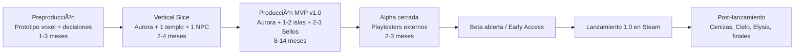

# 03-Diseno.md — DISEÑO DEL PROYECTO (PLAN INICIAL GENERICO)

**Modelo:** Deepseek V4 Flash
**Plataforma:** OpenCode
**Fecha:** 2026-08-15
**Componente:** 01-Fundamentos-Del-Proyecto
**Estado:** Documentación inicial (plan genérico)

---

## 1. Visión de Diseño

> **"Construye tu hogar. Descubre su pasado. Escucha al mundo."**

Un juego donde:
- **Construir** significa colaborar, no imponer (las modificaciones del terreno tienen consecuencias).
- **Explorar** significa descubrir historias, no solo lugares.
- **Las herramientas** sirven para comprender, no para destruir (cero violencia).
- **Los habitantes** son parte de la historia, no simples NPC.

---

## 2. Bucles de Juego (Core Loops)

### 2.1 Bucle Diario (20-45 min)

```
Picar/Recolectar recursos voxel
        │
        â–¼
Decorar pueblo y hablar con vecinos
        │
        â–¼
Vender excedentes y pagar mejoras de infraestructura
        │
        └─────── (reinicia al día siguiente) ───────┘
```

### 2.2 Bucle Semanal (Misterios)

```
Explorar ruinas/templos subterráneos
        │
        â–¼
Resolver acertijos ambientales (luz, presión, agua, viento)
        │
        â–¼
Obtener herramientas de aventura y Reliquias (Fragmentos de Sello)
```

### 2.3 Bucle Mensual (Expansión)

```
Comprar el Boleto de Pasaje (Gemas + Sello requerido)
        │
        â–¼
Abordar el Gran Vapor / Dirigible (carga diegética)
        │
        â–¼
Explorar una nueva isla temática
        │
        â–¼
Desbloquear vecinos, flora rara y materiales únicos
```

---

## 3. Flujo del Jugador (Player Journey v1.0)

1. **Mes 1:** Llegada a Aurora (Isla Base). Tienda de campaña. Aprende a picar bloques, construye su primera casa, conoce a Finneas (Administrador) y los 2 primeros vecinos. Paga la primera cuota.
2. **Semana 2-3:** Descubre una grieta en las montañas. Entra al Templo de la Brisa (sin enemigos). Resuelve puzzles de luz y botones usando el Gancho Mecánico. Obtiene el **Sello de la Brisa** → el faro de Aurora se enciende.
3. **Día 1 del Mes 2:** El Gran Vapor atraca. Compra el **Boleto a las Islas de Coral** (Gemas de Ámbar + Sello de la Brisa).
4. **Viaje:** Explora la Isla de Coral. Descubre frutas tropicales, invita a un vecino nuevo y junta materiales raros. Regresa a Aurora a seguir expandiendo su hogar.
5. **(Opcional v1.0):** Templo de la Marea para el Sello de la Marea y la Vara de Flujo.

---

## 4. Arquitectura de Software

### 4.1 Estructura de Carpetas (independiente del motor — ver motor en 02-Analisis)

```
Assets/                              ← Unity (o estructura equivalente en Godot)
├── _Project/
│   ├── Scripts/
│   │   ├── Core/                    ← Bootstrapping, managers, service locator
│   │   ├── Gameplay/                ← Jugador, herramientas, interacción, construcción
│   │   ├── World/                   ← Voxel: chunks, meshing, generación, terreno
│   │   ├── Puzzle/                  ← Framework Emisor→Receptor, templos
│   │   ├── AI/                      ← NPC, rutinas, pathfinding, animales
│   │   ├── Economy/                 ← Wallets (Ámbar/Mérito), tiendas, infraestructura
│   │   ├── Narrative/               ← Diálogo, flags, misiones, historia
│   │   ├── Systems/                 ← Tiempo, calendario, clima, estaciones, eventos
│   │   ├── Audio/                   ← Managers de audio, mixers
│   │   ├── UI/                      ← Solo vistas; sin lógica de gameplay
│   │   ├── Data/                    ← ScriptableObjects de datos (bloques, recetas, NPC)
│   │   ├── Persistence/             ← GameState versionado, diffs de chunks, saves
│   │   └── Utils/                   ← Helpers, extensiones, math
│   ├── Prefabs/  Materials/  Textures/  Models/  Animations/
│   ├── Audio/  Scenes/  Shaders/  ScriptableObjects/
├── Editor/                          ← Build scripts, herramientas internas
├── Plugins/  StreamingAssets/
```

**Namespaces por sistema:** `IslaAncestral.Core`, `IslaAncestral.World`, `IslaAncestral.Puzzle`, `IslaAncestral.Economy`, etc.

### 4.2 Diagrama de Capas

```
┌──────────────────────────────────────────────┐
│ UI (Canvas/UGUI o Godot UI) — Vista           │  ← solo eventos, sin lógica
├──────────────────────────────────────────────┤
│ Managers / Servicios (singletons, locator)    │  ← orquestación
├──────────────────────────────────────────────┤
│ Systems: Voxel · Puzzle · Economy · AI ·      │
│          Narrative · Time/Weather · Audio      │  ← lógica de gameplay
├──────────────────────────────────────────────┤
│ Data (ScriptableObjects / Resources)          │  ← datos configurables
├──────────────────────────────────────────────┤
│ Persistence (GameState versionado + diffs)    │  ← guardado
└──────────────────────────────────────────────┘
```

### 4.3 Patrones y Contratos Clave

| Patrón | Uso |
|--------|-----|
| Event Bus / Observer | Reloj central (día, estación, clima) notifica a sistemas |
| Service Locator | Acceso a managers sin acoplar |
| ScriptableObject Architecture | Datos de bloques, recetas, NPC, diálogos |
| Interfaces | `IInteractable`, `ISignalEmitter`, `ISignalReceiver`, `IWorldState` |
| Composición | Prefabs modulares sobre herencia profunda |
| Command/Undo (opcional) | Modo construcción con deshacer |

---

## 5. Diseño del Sistema Voxel

| Concepto | Decisión |
|----------|----------|
| Tamaño de voxel | 1×1×1 m (coincide colisión, escala personaje ~1.8 m) |
| Tamaño de chunk | 16³ o 32³ voxels (evaluar en prototipo) |
| Procesamiento | Solo chunks activos en memoria; streaming por distancia |
| Malla | Face culling obligatorio; greedy meshing a evaluar |
| Hilos | Generación/remallado en hilos secundarios |
| LOD | Chunks lejanos simplificados |
| Colisiones | Raycast contra grilla de voxels (no contra malla) |
| Persistencia | Diffs por chunk (bloques vs. generación original) |
| Bloques líquidos | Agua, nieve, arena con comportamiento propio (evaluar) |
| Interacción | Pala (tierra/césped), Pico (piedra/minerales), Hacha (madera sin destruir árbol completo) |

---

## 6. Diseño del Framework de Puzzles (Emisor → Receptor)

```
[Emisor] ──señal──> [Medio transportador] ──señal──> [Receptor] ──acción──> [Mecanismo]

Ejemplos:
- Espejo (emisor de LUZ)  → haz guiado        → Receptor de luz → abre puerta
- Placa de presión (emisor de PESO)           → Receptor → activa plataforma
- Bloque deslizante (empujado por jugador)    → Receptor → cierra canal de agua
- Vara de Flujo (emisor AGUA/FRIO)            → Receptor → congela/evapora agua
- Gancho Mecánico (input del jugador)         → Punto de anclaje → cruza abismo
- Lanza-Semillas (input del jugador)          → Maceta lejana → crece planta → abre puerta
```

**Reglas de diseño:**
1. Toda mecánica de templo debe poder expresarse como combinación de emisor/receptor.
2. Las herramientas del jugador son "inputs" que activan receptores específicos.
3. Cada templo nuevo = componer piezas con skin temática distinta (SN); no programar mecánica nueva.
4. Pistas opcionales por templo; sin soluciones ambiguas; checkpoints y reinicio de puzzle.

---

## 7. Diseño de Datos (GameState)

```
GameState v1.0 (versionado)
├── Player: posición, inventario, hotbar, herramientas
├── Wallets: { gemasAmbar, pasesDeMerito }
├── Relations: { npcId → { puntosDeAmistad, nivel, flags } }
├── Progression: { sellos[], gRABACIONESescuchadas[], islasVisitadas[], historiaStage }
├── WorldDiffs: { chunkId → { bloqueModificado → tipoNuevo } }  (persistencia voxel incremental)
├── Crops: { parcelaId → { semilla, etapa, riego } }
├── Calendar: { fecha, hora, estacion, año }
└── Settings: { controles, accesibilidad, audio, graficos }
```

**Regla:** todo save incluye `schemaVersion`; las migraciones se ejecutan al cargar; los saves corruptos se detectan y se recuperan de backup.

---

## 8. Diseño del Sistema de Guardado

1. Autosave periódico + guardado manual en slots.
2. Serialización incremental: solo diffs de chunks modificados.
3. Escritura fuera del hilo principal; sin congelamientos.
4. Pruebas: apagado a mitad de guardado, falta de espacio, múltiples perfiles.

---

## 9. Estructura de Documentación del Proyecto

```
DOCUMENTACION/
├── 1-DOCUMENTO-DE-ESPECIFICACIONES-ACTUAL.md
├── 2-DOCUMENTO-DISENO-ACTUAL.md
├── 3-DOCUMENTO-TAREAS-ACTUAL.md
├── 4-DOCUMENTO-EJECUCION-ACTUAL.md
├── 5-FUTURAS-MEJORAS.md
├── 00-PLAN-INICIAL/                    ← Origen (no modificar)
├── 01-Fundamentos-Del-Proyecto/        ← ESTE componente
│   ├── plan-inicial/                   ← Base (no modificar)
│   └── plan-actual/                    ← Vigente (actualizar aquí)
├── 02-... hasta 152-... per módulo
├── INVESTIGACION SOBRE OTROS JUEGOS/
README.md (DOCUMENTACION)
```

---

## 10. Roadmap de Producción (Fases)



---

## 11. Decisiones de Diseño Cerradas (Resumen)

| # | Decisión | Estado |
|---|----------|--------|
| 1 | Cero violencia y cero penalizaciones violentas | CERRADA (filosofía del juego) |
| 2 | Framework de puzzles emisor→receptor | CERRADA |
| 3 | GameState versionado desde el día uno | CERRADA |
| 4 | Localización con claves desde el día uno | CERRADA |
| 5 | Escenas separadas con carga diegética entre islas | CERRADA |
| 6 | Diferenciación por narrativa + dirección de arte | CERRADA (estrategia) |
| 7 | Motor (Unity/Godot) | **ABIERTA** — se cierra en prototipo |
| 8 | Middleware de audio | **ABIERTA** — módulo 40 |
| 9 | Modelo de negocio (DLC vs gratis) | **ABIERTA** — módulo 94 |
| 10 | Multijugador | **ABIERTA** — módulo 75 |
---

## Specs M01 (Beam 481)

### M01 Visión y Concepto
- Spec: nombre definitivo del proyecto, pilares de diseño (construir colaborar, explorar historias, herramientas para comprender), pitch de una línea, alcance v1.0. Coherente con 01-Requerimientos y 02-Analisis.

### M02 Documentación del Proyecto
- Spec: GDD, narrativa, sistemas, convenciones de código, backlog inicial. Documentación viva en DOCUMENTACION/ (plan-inicial/plan-actual). Coherente con AGENTS.md §3 y §11.

### M08 Terreno y Geografía
- Spec: montañas, valles, ríos, playas, biomas de Aurora (isla principal). Voxel 1×1×1 m, chunks 16³/32³, streaming por distancia. Coherente con M27 (islas) y M09 (generación).

### M09 Generación del Mundo
- Spec: seed determinista, generador de terreno/biomas/vegetación/minerales/cuevas. PRNG por contexto (M10). Regen 80/0 conserva anclas. Coherente con M10 (anclas) y M27 (islas).

### M11 Cámara
- Spec: tercera persona cenital inclinada, zoom configurable, clipping, sensibilidad. Coherente con M10 (jugador) y M154 (visión).
### M12 Herramientas
- Spec: pala, pico, hacha, gancho mecánico, lanza-semillas, vara de flujo. Sin daño (cero violencia). Cada herramienta es un "input" que activa receptores específicos (framework de puzzles). Coherente con M13 (inventario) y M06 (puzzles).

### M13 Inventario
- Spec: slots, stacks, hotbar, cofres, transferencia rápida, peso. Persistido en GameState. Coherente con M14 (recursos) y M07 (guardado).

### M14 Recursos
- Spec: madera, piedra, arena, minerales, frutas, peces, rareza, respawn. Rareza independiente por sistema (catálogo vs pesca). Coherente con M15 (crafting) y M27 (islas).

### M15 Crafting
- Spec: banco de trabajo, recetas, desbloqueos, preview, feedback. Recetas consumen recursos del inventario. Coherente con M14 (recursos) y M16 (construcción).

### M16 Construcción
- Spec: modo construcción/decoración, grid, snapping, rotación, demolición. Command/Undo opcional. Coherente con M17 (casas) y M13 (inventario).
### M17 Casas
- Spec: parcelas, ampliaciones, habitaciones, muebles interactivos, almacenamiento. Casas como nodos en el mundo voxel con persistencia en GameState. Coherente con M16 (construcción) y M13 (inventario).

### M18 NPC y Vecinos
- Spec: especies, personalidades, rutinas, horarios, hogares, relaciones. IA por behavior trees / state machines. Coherente con M19 (amistad) y M20 (diálogos).

### M19 Sistema de Amistad
- Spec: puntos de amistad, niveles, regalos, desbloqueos, eventos únicos. Persistido en GameState (Relations). Coherente con M18 (NPC) y M20 (diálogos).

### M20 Diálogos
- Spec: motor por nodos, flags narrativos, opciones, localización. Coherente con M18 (NPC) y M21 (historia).

### M21 Historia Principal
- Spec: prólogo, capítulos, Sellos, templos, finales y ritmo. Narrativa lineal con ramificaciones por Sellos. Coherente con M22 (historias secundarias) y M20 (diálogos).
### M23 Templos y Puzzles
- Spec: framework emisor→receptor (luz, peso, agua, viento). Dificultad progresiva, pistas opcionales, checkpoints, reinicio de puzzle. Cada templo nuevo = componer piezas con skin temática (sin mecánica nueva). Coherente con M06 (puzzles) y M25 (templo subterráneo).

### M25 Templo Subterráneo
- Spec: Templo de la Brisa como tutorial: entrada, salas, cámara del Sello. Primer templo del jugador; enseña mecánicas emisor→receptor. Coherente con M23 (templos) y M21 (historia).

### M26 Islas del Mundo
- Spec: Isla de Coral, Verde, Cenizas, Cielo — diseño completo por isla (biomas, flora/fauna, POI, música). Coherente con M27 (islas) y M28 (viajes).
### M12 Herramientas (iter.2)
- Spec: pala, pico, hacha, gancho mecánico, lanza-semillas, vara de flujo (sin daño). Cada herramienta es un "input" que activa receptores específicos. Coherente con M13 (inventario) y M06 (puzzles).

### M21 Historia Principal (iter.2)
- Spec: prólogo, capítulos, Sellos, templos, finales y ritmo. Narrativa lineal con ramificaciones por Sellos. Coherente con M22 (historias secundarias) y M20 (diálogos).

### M40 Música
- Spec: acústica/lo-fi por bioma, leitmotifs, música adaptativa, loops. Coherente con M41 (audio) y M31 (ciclo).

### M44 Arte 3D
- Spec: estilo cozy voxel redondeado, presupuesto de polígonos, LOD. Coherente con M45 (shaders) y M60 (rendimiento).

### M60 Rendimiento
- Spec: 60 FPS, presupuestos, profiling, culling, batching, instancing. Coherente con M61 (rendimiento) y M63 (streaming).
### M139 Alpha
- Spec: Alpha — mecánicas completas, historia jugable, primer balance, QA intensivo. Coherente con M138 (pre-alpha) y M140 (beta).
## Specs M01 (Beam 524) — Clima, Agricultura, Pesca, Minería, Fauna

### M31 Clima
- Spec: sol, lluvia, tormenta, niebla, nieve, transiciones, accesibilidad. Coherente con M31 (ciclo) y M58 (accesibilidad).

### M32 Agricultura
- Spec: parcelas, semillas, riego, fertilizante, estaciones, plantas ancestrales. Coherente con M33 (agricultura) y M29 (tiempo).

### M33 Pesca
- Spec: especies, minijuego no frustrante, coleccionario, peces legendarios. Coherente con M34 (pesca) y M73 (colección).

### M34 Minería
- Spec: vetas, profundidad, minerales ancestrales, derrumbes controlados. Coherente con M35 (minería) y M14 (recursos).

### M35 Fauna
- Spec: especies no hostiles, hábitat, migraciones, observación, ecosistemas. Coherente con M35 (fauna) y M27 (islas).
## Specs M01 (Beam 524b) — Museos, Infraestructura, Música, Arte 3D, Arte 2D

### M36 Museos y Colecciones
- Spec: salas, vitrinas, fósiles, porcentaje completado. Coherente con M36 (museos) y M73 (colección).

### M39 Infraestructura
- Spec: puentes, rampas, faro, puerto, plaza, proyectos de Finneas. Coherente con M39 (infraestructura) y M16 (construcción).

### M40 Música
- Spec: acústica/lo-fi por bioma, leitmotifs, música adaptativa, loops. Coherente con M40 (música) y M41 (audio).

### M44 Arte 3D
- Spec: estilo cozy voxel redondeado, presupuesto de polígonos, LOD. Coherente con M44 (arte 3D) y M60 (rendimiento).

### M45 Arte 2D
- Spec: logo, iconos, UI, mapas, símbolos ancestrales, guías de estilo. Coherente con M45 (arte 2D) y M53 (UI).
## Specs M01 (Beam 524c) — Texturas, Iluminación, Vegetación, Agua, Partículas

### M46 Texturas y Materiales
- Spec: tierra, césped, piedra, agua, variantes por bioma. Coherente con M46 (texturas) y M08 (terreno).

### M48 Iluminación
- Spec: URP/Forward+, GI suave, horaria, faroles, cuevas, optimización. Coherente con M48 (iluminación) y M31 (ciclo).

### M49 Vegetación
- Spec: hierba, árboles ancestrales, plantas luminosas, viento, instancing. Coherente con M49 (vegetación) y M50 (agua).

### M50 Agua
- Spec: océano, ríos, cascadas, congelamiento, evaporación, puzzles hidráulicos. Coherente con M50 (agua) y M51 (partículas).

### M51 Partículas y VFX
- Spec: polvo, hojas, Resonancia, activación de runas, obtención de Sello. Coherente con M51 (partículas) y M48 (iluminación).
## Specs M01 (Beam 524d) — Mapa

### M53 Mapa
- Spec: mapa global, descubrimiento progresivo, marcadores, leyenda. Coherente con M53 (mapa) y M54 (mapa).
## Specs M01 (Beam 525) — Diario, Fotografía, Interfaz de Control, Accesibilidad, Guardado, Datos

### M55 Fotografía
- Spec: modo fotografía, filtros, álbum, galería. Coherente con M55 (fotografía) y M56 (interfaz).

### M56 Interfaz de Control
- Spec: teclado, ratón, gamepad, remapeo, Steam Deck. Coherente con M56 (interfaz) y M57 (accesibilidad).

### M57 Accesibilidad
- Spec: daltonismo, subtítulos, texto ajustable, reducción de movimiento. Coherente con M57 (accesibilidad) y M56 (interfaz).

### M58 Guardado
- Spec: autosave, slots, GameState versionado, backups, recuperación. Coherente con M58 (guardado) y M59 (datos).

### M59 Datos y Serialización
- Spec: formato, IDs persistentes, versionado de schema, migraciones. Coherente con M59 (datos) y M58 (guardado).
## Specs M01 (Beam 525b) — Rendimiento, Cargas, IA, Anti-Softlock, Vehículos

### M60 Rendimiento
- Spec: 60 FPS, presupuestos, profiling, culling, batching, instancing. Coherente con M60 (rendimiento) y M61 (memoria).

### M62 Cargas y Streaming
- Spec: carga asíncrona, chunks cercanos, progreso real. Coherente con M62 (cargas) y M63 (IA de NPC).

### M64 Animales IA
- Spec: comportamiento no hostil, migraciones, spawn/despawn. Coherente con M64 (animales IA) y M35 (fauna).

### M65 Anti-Softlock
- Spec: recuperación de objetos clave, reinicio de puzzles, fallbacks. Coherente con M65 (anti-softlock) y M23 (templos).

### M66 Vehículos
- Spec: barco (y post-v1.0 submarino), física, cámara, docking. Coherente con M66 (vehículos) y M67 (transporte).
## Specs M01 (Beam 525c) — Transporte, Progresión, Logros, Eventos, Postgame

### M67 Transporte y Navegación
- Spec: puerto, rutas, señalización, fast travel narrativo. Coherente con M67 (transporte) y M68 (fast travel).

### M70 Progresión
- Spec: narrativa, herramientas, construcción, social, islas, desbloqueos. Coherente con M70 (progresión) y M71 (logros).

### M71 Sistema de Logros
- Spec: básicos, exploración, social, colección, secretos. Coherente con M71 (logros) y M72 (coleccionables).

### M73 Eventos
- Spec: festivales estacionales, llegada del vapor, eventos raros. Coherente con M73 (eventos) y M74 (postgame).

### M74 Postgame
- Spec: Era del Alba, nuevas islas, objetivos 100%, contenido libre. Coherente con M74 (postgame) y M73 (eventos).
## Specs M01 (Beam 526) — Multijugador, Online, Legal, Privacidad, Menores

### M75 Multijugador
- Spec: decidir local/online, cantidad, voz de diseño (post-v1.0). Coherente con M75 (multijugador) y M76 (online).

### M76 Online y Red
- Spec: cliente-servidor, sincronización, latencia, seguridad (post-v1.0). Coherente con M76 (online) y M75 (multijugador).

### M77 Legal — Propiedad Intelectual
- Spec: marcas, autoría, licencias, terceros. Coherente con M77 (legal) y M82 (licencias).

### M79 Legal — Privacidad
- Spec: GDPR/COPPA, política de privacidad, consentimientos. Coherente con M79 (privacidad) y M80 (menores).

### M80 Legal — Menores
- Spec: clasificación, controles parentales, contenido. Coherente con M80 (menores) y M81 (clasificación).
## Specs M01 (Beam 526b) — Clasificación, Licencias, Modelos 3D, Localización, Fuentes

### M81 Clasificación por Edades
- Spec: IARC/ESRB/PEGI (cero violencia → permisiva). Coherente con M81 (clasificación) y M80 (menores).

### M82 Licencias de Software
- Spec: engine, plugins, fuentes, librerías. Coherente con M82 (licencias) y M77 (legal PI).

### M84 Modelos 3D — Legal
- Spec: licencias de cada modelo, atribución, registro. Coherente con M84 (modelos 3D legal) y M77 (legal PI).

### M86 Localización
- Spec: idioma base, claves, tablas, QA lingüístico. Coherente con M86 (localización) y M87 (fuentes).

### M87 Fuentes Tipográficas
- Spec: fuente principal/secundaria, licencia, tildes y ñ. Coherente con M87 (fuentes) y M86 (localización).
## Specs M01 (Beam 526c) — Menús, Audio, Tutorial, Balance, Retención

### M88 Diseño de Menús
- Spec: principal, pausa, inventario, ajustes, créditos. Coherente con M88 (menús) y M53 (UI).

### M90 Configuración de Audio
- Spec: volúmenes independientes, rango dinámico. Coherente con M90 (audio) y M41 (sonido ambiental).

### M91 Tutorial
- Spec: movimiento, cámara, recolección, construcción, progresivo. Coherente con M91 (tutorial) y M92 (tutorial).

### M92 Balance
- Spec: precios, recompensas, crafting, amistad, simulación económica. Coherente con M92 (balance) y M93 (retención).

### M93 Retención sin FOMO
- Spec: objetivos diarios/semanales, sin castigos por ausencia. Coherente con M93 (retención) y M94 (monetización).
## Specs M01 (Beam 526d) — Monetización, Plataformas, Logging, Analytics, Telemetría

### M94 Monetización
- Spec: premium, DLC de islas vs contenido gratis, precio. Coherente con M94 (monetización) y M95 (plataformas).

### M95 Plataformas
- Spec: PC/Steam prioritario, Steam Deck, EGS/GOG a evaluar. Coherente con M95 (plataformas) y M94 (monetización).

### M102 Logging
- Spec: niveles, rotación, crash reporting, exportación. Coherente con M102 (logging) y M103 (analytics).

### M103 Analytics
- Spec: eventos, sesiones, anonimización, dashboard. Coherente con M103 (analytics) y M104 (telemetría).

### M104 Telemetría de Gameplay
- Spec: tutorías, abandono de puzzles, zonas ignoradas. Coherente con M104 (telemetría) y M103 (analytics).
## Specs M01 (Beam 527) — Seguridad, Pipeline, Herramientas, Testing, Pruebas de Stress

### M105 Seguridad
- Spec: APIs, claves, validación, anti-manipulación (si online). Coherente con M105 (seguridad) y M76 (online).

### M107 Pipeline de Assets
- Spec: naming, carpetas, formatos, import settings, validadores. Coherente con M107 (pipeline) y M108 (herramientas internas).

### M108 Herramientas Internas
- Spec: editores de bloques/NPC/diálogos/recetas, teleport. Coherente con M108 (herramientas) y M109 (debug menu).

### M111 Testing Automático
- Spec: unit, integración, save/load, economía, voxel, navegación. Coherente con M111 (testing) y M112 (pruebas de stress).

### M112 Pruebas de Stress
- Spec: miles de bloques, muchos NPC, sesiones largas. Coherente con M112 (stress) y M111 (testing).
## Specs M01 (Beam 527b) — Hardware, Actualizaciones, Crash Reporting, Modding, Contenido UGC

### M114 Hardware
- Spec: PC mínimo/recomendado, GPU integrada/dedicada, SSD/HDD. Coherente con M114 (hardware) y M60 (rendimiento).

### M118 Actualizaciones
- Spec: patches, versionado, compatibilidad de saves, migraciones. Coherente con M118 (actualizaciones) y M59 (datos).

### M121 Crash Reporting
- Spec: captura de stack, versión, agrupación, priorización. Coherente con M121 (crash reporting) y M102 (logging).

### M122 Modding
- Spec: decidir si habrá, API, seguridad (opcional muy a futuro). Coherente con M122 (modding) y M123 (UGC).

### M123 Contenido Generado por Usuarios
- Spec: moderación, privacidad, términos. Coherente con M123 (UGC) y M122 (modding).
## Specs M01 (Beam 527c) — Marketing Legal, Copyright, Identidad de Marca, Merchandising, Créditos

### M125 Marketing Legal
- Spec: screenshots, música, influencers, claims. Coherente con M125 (marketing legal) y M94 (monetización).

### M126 Copyright del Juego
- Spec: registro, evidencias de autoría, titulares. Coherente con M126 (copyright) y M77 (legal PI).

### M127 Identidad de Marca
- Spec: nombre (verificar colisión), logo, paleta, símbolo de Aurora. Coherente con M127 (identidad) y M88 (menús).

### M128 Merchandising
- Spec: soundtrack, poster, artbook (post-lanzamiento). Coherente con M128 (merchandising) y M94 (monetización).

### M130 Créditos
- Spec: todos los roles, licencias, herramientas, agradecimientos. Coherente con M130 (créditos) y M82 (licencias).
## Specs M01 (Beam 527d) — Prototipo

### M136 Prototipo
- Spec: movimiento, cámara, voxel básico, extracción/colocación, mini puzzle, save. Coherente con M136 (prototipo) y M137 (vertical slice).
## Specs M01 (Beam 528) — Beta, Lanzamiento, Después del Lanzamiento, Diseño de Experiencia

### M140 Beta
- Spec: contenido completo, rendimiento objetivo, cero bugs críticos, localización. Coherente con M140 (beta) y M141 (release candidate).

### M142 Lanzamiento
- Spec: publicación en Steam, monitoreo, hotfix de emergencia. Coherente con M142 (lanzamiento) y M141 (release candidate).

### M143 Después del Lanzamiento
- Spec: reviews, bugs, rendimiento, retención, parches. Coherente con M143 (post-lanzamiento) y M142 (lanzamiento).

### M144 Diseño de Experiencia
- Spec: sensación de llegada, descubrimiento, hogar, comunidad, misterio. Coherente con M144 (diseño de experiencia) y M145 (diseño emocional).
## Specs M01 (Beam 528b) — Diseño Emocional, Nombres, Control Final, Objetivo Final

### M145 Diseño Emocional
- Spec: calma, sorpresa, nostalgia, pertenencia, legado. Coherente con M145 (diseño emocional) y M144 (diseño de experiencia).

### M148 Nombres y Nomenclatura
- Spec: islas, personajes, Sellos, consistencia, marcas. Coherente con M148 (nombres) y M147 (lore ambiental).

### M150 Control Final
- Spec: verificación integral: diversión, economía, mundo vivo, rendimiento. Coherente con M150 (control final) y M149 (diseño sonoro narrativo).

### M152 Objetivo Final del Proyecto
- Spec: Aurora como hogar, curiosidad por explorar, mundo vivo post-créditos. Coherente con M152 (objetivo final) y M150 (control final).